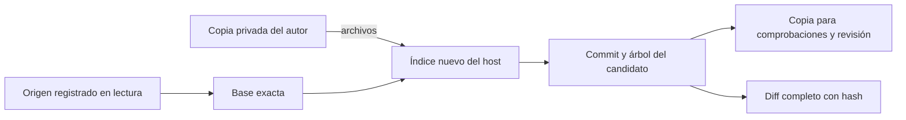

# Captura de candidatos de código

La captura produce un commit y un árbol Git exactos en una copia independiente,
con un diff completo que incluye binarios. No modifica las referencias, el índice
ni los archivos del repositorio original o de la copia del autor.

Este componente interno todavía necesita un controlador que cierre los escritores,
registre el candidato de forma durable y lo vincule al intento y al contexto.
**No habilita desarrollo público, revisión, aceptación ni publicación.**

## Qué se captura

`capture_candidate()` recibe el registro original, la identidad física de la copia
preparada y un ejecutor Git seleccionado por el host. Crea un repositorio nuevo
con la base exacta admitida y prepara su índice leyendo los archivos de la copia
del autor. No utiliza la configuración, el índice, las referencias ni los commits
que el agente haya dejado en esa copia.

Se incluyen los archivos rastreados y los nuevos que no estén ignorados por Git.
Una regla nueva en `.gitignore` no oculta modificaciones de archivos ya rastreados.
El diff compara la base con el árbol capturado y representa adiciones, borrados,
cambios de permisos y contenido binario; no depende de un registro de herramientas
ni del relato del agente. Los renombres se representan como borrado y adición,
conservando el contenido completo.

La caché raíz `.ken` queda fuera del árbol. Si la base ya rastrea esa ruta, la
captura se rechaza para exigir una política explícita, en lugar de omitir datos
silenciosamente. Los repositorios incrustados que generarían gitlinks también se
rechazan: requieren un contrato de candidatos de varios repositorios.

## Identidades y límites

`CapturedCodeCandidate` contiene repositorio, commit base, commit capturado, árbol,
directorio físico y diff con SHA-256. Las identidades Git fijan los bytes del
candidato; una modificación posterior en la copia del autor no cambia ese commit.
Un diff vacío puede representar ausencia de cambios y no prueba que la tarea esté
completada.

La ejecución utiliza `OwnedGitExecutor` y el broker del intento original: origen
en lectura, una asignación privada en escritura, entorno sin credenciales y cada
proceso con cierre comprobado. No se abre un subprocess del host como alternativa.
El componente requiere salida completa y un plazo total de hasta 300 segundos;
el plazo predeterminado es 60 segundos y el diff se limita a un MiB. Una salida
mayor o una terminación sin cierre físico confirmado bloquea el resultado.

Se revalida el directorio del autor, se compara el árbol preparado dos veces y se
comprueba otra vez la base original al terminar. Si el usuario avanza esa base,
se conserva la asignación pero no se devuelve un candidato como vigente. Las
asignaciones existentes nunca se reinicializan ni se borran al repetir una captura.

Ejemplo: el agente edita `price.py` de 137 a 200 y se captura A. Después cambia su
copia a 300. Las comprobaciones de A deben seguir leyendo 200 desde la copia del
candidato. Sus resultados no pueden aprobar B, el candidato que contiene 300.

## Integración pendiente

El controlador debe cerrar y comprobar todos los escritores antes de capturar.
La doble comparación del árbol detecta cambios observables, pero no sustituye esa
barrera: por sí sola no demuestra ausencia de un escritor concurrente.

Debe reservar y persistir la identidad del candidato antes de ejecutar sus pasos,
con proyecto, tarea, repositorio, intento, propietario, fence y versión de contexto.
Un fallo entre Git y SQLite necesita reconciliación sobre la asignación retenida;
un reintento no debe crear otro commit o adoptar archivos existentes sin evidencia.
La captura debe ocurrir antes de retirar el dominio original: el broker prohíbe
crear un dominio nuevo para repetir efectos de ese mismo intento.

Después, comprobaciones y revisión independiente deben consumir la copia exacta
del candidato en lectura y registrar base/head/contexto. La aceptación del usuario
y la publicación son pasos distintos; publicar exige revalidar el destino y poder
reconciliar una respuesta perdida. Este documento no declara implementados esos
contratos pendientes.

Las evidencias de este incremento están en
[code-candidate-results.json](code-candidate-results.json),
[code-candidate-packaging.json](code-candidate-packaging.json) y
[code-candidate-docstrings.json](code-candidate-docstrings.json). La suite completa
conserva los 100 casos heredados fallando y las tres omisiones de contenedores;
no es una suite general en verde. Los escenarios nuevos pasan y la comparación
no añade identidades de fallo respecto a la línea base registrada.
