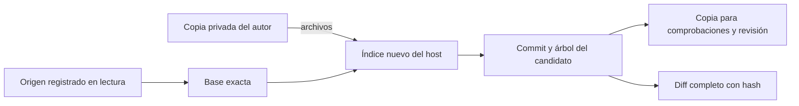

# Captura de candidatos de código

La captura produce un commit y un árbol Git exactos en una copia independiente,
con un diff completo que incluye binarios. No modifica las referencias, el índice
ni los archivos del repositorio original o de la copia del autor.

La sesión interna ya dispone de un controlador que cierra los escritores,
registra el candidato de forma durable y lo vincula al intento y al contexto.
**No habilita desarrollo público, revisión, aceptación ni publicación.**

## Qué se captura

`capture_candidate()` recibe el registro original, la identidad física de la copia
preparada y un ejecutor Git seleccionado por el host. Crea un repositorio nuevo
con la base exacta admitida y prepara su índice leyendo los archivos de la copia
del autor. No utiliza la configuración, el índice, las referencias ni los commits
que el agente haya dejado en esa copia.

Se incluyen los archivos rastreados y los nuevos que no estén ignorados por Git.
Una regla nueva en `.gitignore` no oculta modificaciones de archivos ya rastreados.
El diff compara la base con el árbol capturado y representa adiciones, borrados,
cambios de permisos y contenido binario; no depende de un registro de herramientas
ni del relato del agente. Los renombres se representan como borrado y adición,
conservando el contenido completo.

La caché raíz `.ken` queda fuera del árbol. Si la base ya rastrea esa ruta, la
captura se rechaza para exigir una política explícita, en lugar de omitir datos
silenciosamente. Los repositorios incrustados que generarían gitlinks también se
rechazan: requieren un contrato de candidatos de varios repositorios.

## Identidades y límites

`CapturedCodeCandidate` contiene repositorio, commit base, commit capturado, árbol,
directorio físico y diff con SHA-256. Las identidades Git fijan los bytes del
candidato; una modificación posterior en la copia del autor no cambia ese commit.
Un diff vacío puede representar ausencia de cambios y no prueba que la tarea esté
completada.

La ejecución utiliza `OwnedGitExecutor` y el broker del intento original: origen
en lectura, una asignación privada en escritura, entorno sin credenciales y cada
proceso con cierre comprobado. No se abre un subprocess del host como alternativa.
El componente requiere salida completa y un plazo total de hasta 300 segundos;
el plazo predeterminado es 60 segundos y el diff se limita a un MiB. Una salida
mayor o una terminación sin cierre físico confirmado bloquea el resultado.

Se revalida el directorio del autor, se compara el árbol preparado dos veces y se
comprueba otra vez la base original al terminar. Si el usuario avanza esa base,
se conserva la asignación pero no se devuelve un candidato como vigente. Las
asignaciones existentes nunca se reinicializan ni se borran al repetir una captura.

Ejemplo: el agente edita `price.py` de 137 a 200 y se captura A. Más tarde, otro
intento cambia el valor a 300. Las comprobaciones de A deben seguir leyendo 200
desde su copia del candidato. Sus resultados no pueden aprobar B, el candidato
que contiene 300.

## Reserva, cierre y recuperación

`OwnedInferenceSession.capture_candidate()` exige un turno de desarrollo completado
y reserva el destino en SQLite antes de empezar. Sella la sesión para impedir
otros turnos y llamadas del modelo; después cierra los procesos nativos, comandos
y Ken. El controlador comprueba sus recibos físicos en el diario del broker
original antes de lanzar Git. La doble comparación del árbol sigue siendo una
comprobación adicional; no sustituye la barrera de cierre.

La migración 38 agrega `runtime_code_candidates`. La reserva fija proyecto, tarea,
repositorio, intento, propietario, fence, versión de contexto, base y destino.
La finalización guarda commit, árbol, diff y recibos de cierre en la misma
transacción que el evento durable. Las identidades originales no se pueden editar
y una captura lista es un registro histórico inmutable.

| Estado | Significado |
| --- | --- |
| `capturing` | Reserva durable; todavía no hay un candidato listo. |
| `ready` | Captura exacta registrada bajo el contexto vigente y con evidencia de cierre. Sigue pendiente de comprobaciones y revisión. |
| `reconciling` | Interrupción o corrección durante la captura; se conservan la reserva y los archivos disponibles. |

Un reintento en la misma sesión espera el resultado original; no vuelve a ejecutar
Git. Una reserva encontrada al reabrir almacenamiento permite inspección, sin
autorizar otra captura. Si el usuario corrige después de Git pero antes de SQLite,
la versión anterior no se marca lista y su copia permanece recuperable. Stop
retira y cierra el dominio antes de esperar la observación en SQLite. Un comando
cerrado sin resultado final fiable bloquea el candidato y exige reconciliación.

La captura ocurre antes de retirar el dominio original: el broker prohíbe crear
un dominio nuevo para repetir efectos de ese mismo intento. Después del cierre,
el coordinador puede finalizar la ejecución como pendiente de revisión conservando
el candidato; esto no acepta la tarea. La inversa `restore_code_candidates()` solo
retira almacenamiento sin uso y debe preceder a las inversas 37 y 36. El historial,
la autoridad activa o una versión posterior impiden ese retroceso.

## Integración pendiente

Las comprobaciones ya derivan una copia por receta del candidato exacto y guardan
base/head/contexto junto a sus resultados. La revisión independiente de código
sigue pendiente. La aceptación del usuario y la publicación son pasos distintos;
publicar exige revalidar el destino y poder reconciliar una respuesta perdida.
Este documento no declara implementados esos contratos pendientes.

La integración del controlador tiene evidencia separada en
[candidate-controller-results.json](candidate-controller-results.json),
[candidate-controller-packaging.json](candidate-controller-packaging.json) y
[candidate-controller-docstrings.json](candidate-controller-docstrings.json).
La [prueba con Ken publicado](candidate-controller-published-ken.json) usa
`ken-rank` 0.18.0, MCP y aislamiento reales con generación nativa controlada.
Lee la revisión original y la editada, comprueba 26 recibos de cierre y termina
con candidato listo, ejecución pendiente de revisión y tarea sin aceptar. No
inicia generación de un modelo real.

El escenario inicial confundía la estructura devuelta por `ken_read` con contenido
del archivo. El paquete publicado devuelve símbolos por defecto: comprobar una
línea exige solicitar `include=["source"]`. La prueba corregida hace esa solicitud
explícita; un índice de símbolos no se presenta como evidencia de haber leído
el código.

`ready` describe la captura histórica. No demuestra por sí solo que su contexto
siga vigente al consultarla: los consumidores deben conservar su versión y
revalidarla antes de revisar, aceptar o publicar.

La prueba posterior de Stop durante el cierre confirmó que el contexto podía
terminar con su tarea de cierre aún viva. Ahora el contexto espera esa tarea antes
de liberar el diario; si se cancela la propia espera, cierra primero el dominio
físico y conserva la espera del propietario original. Las pruebas cubren ambos
casos y mantienen la captura interrumpida en reconciliación. Los contratos y la
ejecución de comprobaciones están en [code-checks.md](code-checks.md).

Las evidencias de este incremento están en
[code-candidate-results.json](code-candidate-results.json),
[code-candidate-packaging.json](code-candidate-packaging.json) y
[code-candidate-docstrings.json](code-candidate-docstrings.json). La suite completa
conserva los 100 casos heredados fallando y las tres omisiones de contenedores;
no es una suite general en verde. Los escenarios nuevos pasan y la comparación
no añade identidades de fallo respecto a la línea base registrada.
