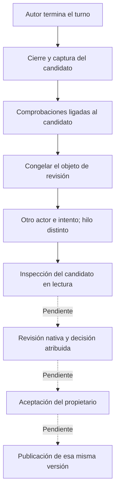

# Admisión de revisión del candidato

El protocolo interno admite una revisión separada de un candidato observado y
permite inspeccionar su directorio en modo de sólo lectura. Conserva requisitos,
autor real, hilo nativo, identidad Git declarada y comprobaciones. La sesión
nativa de revisión, sus decisiones, la aceptación y la publicación siguen
pendientes. El servicio público continúa rechazando tareas de desarrollo.

El recorrido implementado llega a la inspección en lectura. Los tres pasos
finales requieren integración y verificación propias.

## Qué queda congelado

`CodeReviews.subject` construye un objeto completo, con huella SHA-256, que
contiene:

- Proyecto, tarea, repositorio, ejecución e intento del autor, contexto, fence,
  base, commit, árbol y hash del diff del candidato capturado.
- Actor, intento, hilo y turno originales. El autor debe haber terminado y
  conservar evidencia de su peer nativo originalmente despachado y cerrado.
- Requisitos, correcciones y respuestas del contexto actual. El estado de
  progreso de la tarea se excluye de la huella: reclamar una ejecución cambia
  ese estado, sin modificar los requisitos.
- Todos los registros de comprobaciones del candidato, con receta, resultado,
  operación y hashes/tamaños de stdout, stderr y JUnit. Un registro pendiente
  conserva resultado desconocido. Los bytes de salida no se duplican en el
  paquete de revisión.

El objeto completo debe caber en un MiB y en 64 registros de comprobaciones.
Superar esos límites produce un error explícito; no se selecciona una parte
conveniente para presentarla como inspección completa. Los BLOBs se procesan
registro por registro para evitar cargar todas las salidas simultáneamente.

Por ejemplo, el autor produjo el commit A bajo contexto 2. La revisión observa
el hash del objeto que contiene A y sus comprobaciones. Si una corrección crea
contexto 3 o llega una observación tardía que modifica una comprobación, el objeto
guardado sigue disponible como historia y pierde su condición de actual.

## Identidad antes del despacho

`CodeReviewTarget` exige intento del autor y hash observado. `admit_once` registra
en una transacción la ejecución de revisión, su objeto inmutable, la referencia
al repositorio original, el recibo y el evento durable. La misma intención
recupera el recibo original; una clave reutilizada con otro objeto se rechaza.

Se exige otro actor y otra ejecución. `bind_thread` y `bind_native` también
rechazan el hilo nativo del autor. Un nombre como «code reviewer» no acredita
ninguna de esas condiciones. Estas comprobaciones establecen separación
operativa; la comprensión y la calidad del juicio requieren evaluar la revisión.

El repositorio original conserva su registro. `CodeReviewView` identifica por
separado el directorio, dispositivo e inodo del candidato. El broker monta esa
vista en lectura y vuelve a comprobar contexto y origen inmediatamente antes de
abrir la puerta del proceso. Una corrección durante ese intervalo impide el
despacho. El proceso de inspección no recibe una vista del repositorio original.

La vista fija la identidad física del directorio. **Todavía falta validar sus
bytes mediante Git antes y después de la sesión nativa**, conectar las
instrucciones y capacidades exclusivas de revisión y guardar una decisión
atribuida. El runtime nativo rechaza actualmente ese tipo de ejecución de forma
explícita; no lo convierte en una sesión de investigación ni concede permiso
para aceptar tareas.

## Persistencia y recuperación

La migración 40 añade `runtime_code_review_requests`, sus referencias al autor y
candidato y un trigger que impide cambiar un objeto ya admitido. El arranque
aplica la migración atómicamente. La inversa sólo retira almacenamiento de revisión
sin uso, sin autoridad activa ni versiones posteriores. Conserva candidatos y
comprobaciones anteriores; un objeto de revisión retenido bloquea el retroceso
incluso después de finalizar la ejecución de revisión.

Las pruebas de almacenamiento usan identidades Git y procedencia sintéticas,
declaradas como tales. Las dos pruebas de kernel ejercitan el montaje real en
lectura y la corrección antes del despacho. No constituyen una revisión nativa,
un ensayo de calidad de modelo ni una prueba Git de esas identidades sintéticas.

La evidencia de esta etapa está en
[code-review-state-results.json](code-review-state-results.json),
[code-review-state-packaging.json](code-review-state-packaging.json) y
[code-review-state-docstrings.json](code-review-state-docstrings.json). La prueba
previa de [bootstrap del wheel](code-review-state-smoke-packaging.json) pasó 29 casos; el conjunto ampliado pasó 199, sin
fallos ni omisiones. No se ejecutó una nueva suite global ni generación de modelo.
