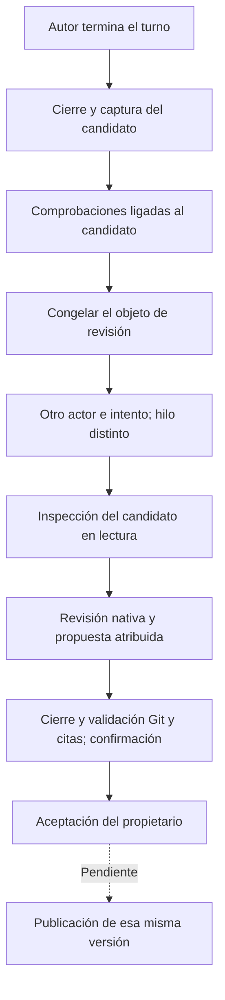

# Revisión independiente del candidato

El recorrido interno conecta una sesión nativa separada con el candidato exacto
del autor, valida Git antes y después, verifica citas y conserva una decisión
atribuida. La [aceptación humana posterior](code-acceptance.md) ya tiene API y panel de
Tareas; publicación y entrada pública de desarrollo siguen pendientes. La admisión nativa sigue siendo interna mediante `review_code`; todavía no hay
acción web para solicitar esa sesión. La aceptación posterior enlazada sí tiene
panel y rutas del propietario.

La confirmación acredita que terminó este protocolo y conserva su evidencia.
La decisión puede ser `supported`, `needs_revision` o `inconclusive`. Ninguna
acepta la tarea, publica el código ni acredita por sí sola su corrección.

## Qué queda congelado

`CodeReviews.subject` construye un objeto completo, con huella SHA-256, que
contiene:

- Proyecto, tarea, repositorio, ejecución e intento del autor, contexto, fence,
  base, commit, árbol y hash del diff del candidato capturado.
- Actor, intento, hilo y turno originales. El autor debe haber terminado y
  conservar evidencia de su peer nativo originalmente despachado y cerrado.
- Requisitos, correcciones y respuestas del contexto actual. El estado de
  progreso de la tarea se excluye de la huella: reclamar una ejecución cambia
  ese estado, sin modificar los requisitos.
- La petición original del propietario (`author_request`), tomada de la admisión
  del autor, con procedencia. Los metadatos de la tarea pueden omitir condiciones
  presentes en esa petición.
- La referencia y huella de la entrada exacta congelada para el autor. El revisor
  puede leer sus bytes históricos separados de su propia entrada. Si falta o
  resulta incongruente, la preparación nativa se rechaza.
- Todos los registros de comprobaciones del candidato, con receta, resultado,
  operación y hashes/tamaños de stdout, stderr y JUnit. Un registro pendiente
  conserva resultado desconocido. Los bytes de salida no se duplican en el
  paquete de revisión.

El objeto completo debe caber en un MiB y en 64 registros de comprobaciones.
Superar esos límites produce un error explícito; no se selecciona una parte
conveniente para presentarla como inspección completa. Los BLOBs se procesan
registro por registro para evitar cargar todas las salidas simultáneamente.

Por ejemplo, el autor produjo el commit A bajo contexto 2. La revisión observa
el hash del objeto que contiene A y sus comprobaciones. Si una corrección crea
contexto 3 o llega una observación tardía que modifica una comprobación, el objeto
guardado sigue disponible como historia y pierde su condición de actual.

## Identidad antes del despacho

`CodeReviewTarget` exige intento del autor y hash observado. `admit_once` registra
en una transacción la ejecución de revisión, su objeto inmutable, la referencia
al repositorio original, el recibo y el evento durable. La misma intención
recupera el recibo original; una clave reutilizada con otro objeto se rechaza.

Se exige otro actor y otra ejecución. `bind_thread` y `bind_native` también
rechazan el hilo nativo del autor. Un nombre como «code reviewer» no acredita
ninguna de esas condiciones. Estas comprobaciones establecen separación
operativa; la comprensión y la calidad del juicio requieren evaluar la revisión.

El repositorio original conserva su registro. `CodeReviewView` identifica por
separado el directorio, dispositivo e inodo del candidato. El broker monta esa
vista en lectura y vuelve a comprobar contexto y origen inmediatamente antes de
abrir la puerta del proceso. Una corrección durante ese intervalo impide el
despacho. El proceso de inspección no recibe una vista del repositorio original.

El dueño reserva el registro de revisión antes de efectos y valida Git en su
dominio original: base, HEAD, árbol, diff binario con argumentos fijados y ausencia
de cambios rastreados/no rastreados. Conserva comprobantes de operaciones cerradas.
Sin este preflight actual, el runtime rechaza despacho y reserva de presupuesto.
Una reserva anterior se inspecciona; no autoriza repetir efectos ni inferencia.

## Capacidades, propuesta y comprensión

El perfil concede lectura y preguntas, más tres herramientas:
`researcher_code_review_subject`, `researcher_code_review_file` y
`researcher_code_review_propose`. No concede edición del candidato, escritura de
hallazgos/informes/wiki, decisiones sobre hallazgos ni aceptación/publicación.
Ken inspecciona la misma vista. Los comandos conservan los límites en lectura.

Las instrucciones distinguen declaraciones, ejemplos, observaciones e inferencias
y piden señalar supuestos. La entrada histórica demuestra qué se proporcionó;
no demuestra comprensión. Piden respuestas en el idioma del usuario y ejemplos,
metáforas o diagramas fieles cuando ayuden. Esto requiere evaluación con casos
representativos; tener instrucciones no satisface la evaluación de comprensión.

La propuesta tiene clave estable, hash exacto del objeto, criterios, razones,
referencias y límites. El host comprueba hashes de bytes y citas en líneas
concretas del archivo o diff y deriva su posición. Rutas con escapes, alias o
componentes `.git`/`.ken` se rechazan. Las lecturas usan descriptores seguros sin
seguir enlaces. Cada ventana explicita su cobertura; una cola no leída sigue
desconocida. Archivos UTF-8: máximo cuatro MiB; propuesta: máximo 256 KiB.

Una cita exacta demuestra coincidencia; su apoyo lógico sigue siendo juicio del
revisor. `supported` exige evidencia y criterios respaldados, sin esconder
criterios declarados preocupantes o sin inspeccionar. Pruebas ausentes, omitidas
y fallos de infraestructura siguen siendo diferentes. Un número de pruebas no
certifica calidad.

El host sella sesión, herramientas y Ken, espera el trabajo en curso, vuelve a
validar Git en el mismo dominio y comprueba de nuevo los bytes citados. Exige
identidad/contexto/concesión originales y cierre de peers reales antes de
confirmar. Reutiliza la tarea dedicada de Ken para evitar cerrar su ámbito
AnyIO desde otra tarea. Stop cierra el dueño físico antes de registrar el fallo.
Correcciones o cambios de fuente conservan la propuesta e impiden confirmación
actual. Una sesión completada sin confirmación termina fallida con
`code_review_unconfirmed`; el coordinador no la presenta como revisión utilizable.

## Persistencia y recuperación

La migración 40 añade `runtime_code_review_requests`, sus referencias al autor y
candidato y un trigger que impide cambiar un objeto ya admitido. El arranque
aplica la migración atómicamente. La inversa sólo retira almacenamiento de revisión
sin uso, sin autoridad activa ni versiones posteriores. Conserva candidatos y
comprobaciones anteriores; un objeto de revisión retenido bloquea el retroceso
incluso después de finalizar la ejecución de revisión.

La migración 41 añade `runtime_code_review_records`: `preparing`, `ready`,
`proposed`, `confirmed` y `reconciling`. Origen, preflight y propuesta son
inmutables; la confirmación es terminal. La inversa sólo retira almacenamiento
sin uso/autoridad activa/versiones posteriores y conserva admisión 40. Historia
retenida bloquea el retroceso incluso después de terminar la ejecución.

El objeto ahora usa esquema 2 por la petición y entrada originales. Objetos de
esquema 1 siguen siendo historia, sin reescritura ni reinterpretación como
actuales. Requieren nueva observación y admisión explícita tras reconciliar el
trabajo anterior; no se reproduce la inferencia anterior.

Las pruebas anteriores de almacenamiento usan identidades Git y procedencia
sintéticas declaradas; las dos de kernel prueban lectura y corrección antes del
despacho. La etapa nativa añade seis integraciones con autor/generación
controlados y Git, SQLite, broker, montaje y cierre reales. Cubren decisión,
corrección, cambio de candidato, Stop durante confirmación y clasificación del
coordinador, incluida alteración de bytes entre Git final y validación de citas.
No constituyen una evaluación de calidad del modelo.

La evidencia de la admisión anterior está en
[code-review-state-results.json](code-review-state-results.json),
[code-review-state-packaging.json](code-review-state-packaging.json) y
[code-review-state-docstrings.json](code-review-state-docstrings.json). La prueba
previa de [bootstrap del wheel](code-review-state-smoke-packaging.json) pasó 29 casos; el conjunto ampliado pasó 199, sin
fallos ni omisiones. Esos recibos conservan su alcance histórico. La [validación ampliada previa del wheel](native-code-review-before-ken-fix-packaging.json) pasa 336
casos sin fallos ni omisiones y carga 375 módulos sólo del paquete. La suite global del artefacto anterior al ajuste de `.ken` terminó con 1993
casos que pasan, 100 fallos heredados y tres omisiones, sin identificadores de
fallo nuevos. No se atribuye esa suite a los bytes finales: el ajuste de dos
archivos se verifica por separado. El ensayo real con suscripción/Ken pasó:
identificó 100,2 frente a 120, registró `needs_revision`, confirmó el protocolo
y cerró sus procesos. Se conservan el fallo inicial del verificador (cero turnos)
y la propuesta del ensayo anterior al ajuste (un turno); hubo dos turnos reales
de revisor en total. El [paquete final corregido](native-code-review-packaging.json) pasa 83 casos sin fallos ni omisiones, incluidas las seis integraciones; 339 módulos sólo del wheel y 691 fuentes coincidentes. [Resultados](native-code-review-results.json), [ensayo real](native-code-review-live.json), [recibo anterior al ajuste](native-code-review-before-ken-fix-packaging.json). Sus
[docstrings](native-code-review-docstrings.json) documentan 138 definiciones
nuevas/modificadas; no acreditan documentación de todo el código histórico.
