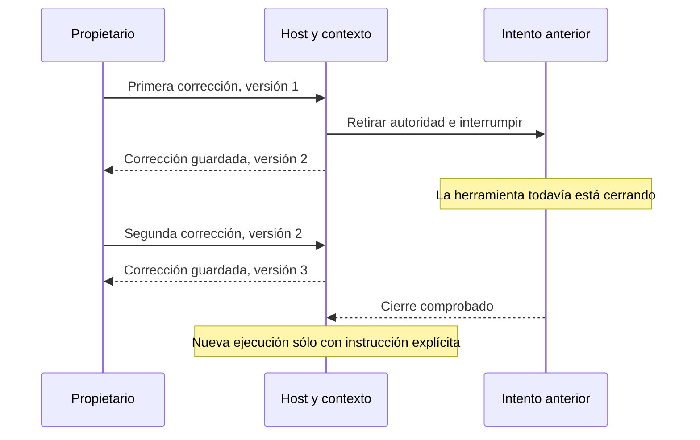

# Comunicación durable y correcciones consecutivas

Bloque iniciado el **7 noviembre 2026, 19:24:02 UTC**, desde `7382aa1`.
**C01–C09 quedan comprobados con el alcance de la matriz; C10 sigue abierto.**
Validación final: **19:38:49 UTC**, **14 min 47 s** desde el inicio. Documentación
y checkpoint posteriores excluidos. Los registros de mensajes no prueban comprensión humana.

## Brecha funcional encontrada y corregida

Una segunda corrección válida se rechazaba mientras el intento anterior cerraba
una herramienta lenta. El primer control avanzaba el contexto de 1 a 2 y retiraba
la autoridad. Pero el worker seguía en el registro para comprobar su cierre, con
su versión original 1. `RuntimeService.correct` comparaba esa versión retirada
con la versión 2 enviada por el propietario y devolvía un conflicto incorrecto.

Ahora sólo los workers que todavía conservan autoridad participan de esa
comprobación e interrupción. SQLite sigue validando la versión vigente y los
recibos; los workers retirados conservan su responsabilidad de cierre. El
finalizador deriva el desenlace del estado durable y no completa trabajo obsoleto.
No se añade otro loop, bus ni proceso.

La regresión reprodujo el conflicto antes del cambio. Después comprueba ambas
correcciones con el presupuesto de un turno completamente reservado, mientras
un trabajo registrado sigue abierto. Sólo después de cerrar, ampliar explícitamente
el presupuesto e instruir un nuevo intento, éste recibe ambas correcciones y la
versión 3. Recibir el input no se presenta como comprensión demostrada del modelo.

## Matriz de escenarios

| Escenario | Evidencia y alcance |
| --- | --- |
| C01: caída entre guardar y entregar | Dos procesos separados terminan mediante `os._exit(73)` después del commit real: instrucción y mensaje entre agentes. La reapertura conserva la cola/inbox y recupera un único recibo, sin despacho adicional. Se cotejan hashes del código ejecutado por el hijo. Los fallos antes del commit revierten mensaje, relación y evento en las pruebas existentes. |
| C02: responsable único frente a rol/broadcast | Dos destinatarios comparten etiqueta y requieren IDs de ejecución distintos; enviar a la etiqueta se rechaza y elegir uno no entrega al otro. La carrera de `claim` conserva un solo dueño. Notas y avisos no activan trabajo ni se convierten en asignación grupal. No se afirma ejecución simultánea de dos modelos reales. |
| C03: respuestas anticipadas, invertidas o tardías | Dos preguntas del mismo hilo reciben respuestas invertidas antes de los acuses. Reabrir el inbox conserva cada `in_reply_to` y su texto. Se retiró el waiter efímero por hilo: no hay timeout de pregunta que borre la respuesta. Un contexto o una lease obsoletos no autorizan nuevos envíos; los mensajes ya registrados permanecen históricos. |
| C04: restricción al final | Una vista previa omite explícitamente el final; las ventanas recuperan todo el mensaje y la restricción con una misma huella. La entrada demasiado grande se rechaza entera. `test_run_input` verifica los bytes enviados y el rechazo antes de reservar inferencia si no caben; material de delegación grande usa referencias/lecturas exactas, también mediante broker real con generación controlada. |
| C05: leer no equivale a aplicar | Leer no borra pendientes ni reconoce comprensión. Una corrección revoca el intento anterior aunque hubiera leído el mensaje; el emisor ajeno a esa tarea sigue pudiendo consultar su evidencia. Reinicio, inputs congelados y correcciones conservan sus versiones. La continuación explícita recibe ambas indicaciones; el intento previo no las declara aplicadas. |
| C06: respuestas antiguas y semejanza | Una pregunta idéntica en el contexto nuevo queda pendiente, sin copiar la respuesta antigua. Recuperar el recibo anterior devuelve su versión histórica sin alterar la nueva. Pregunta, respuesta, procedencia y sustituciones permanecen; los registros de reutilización semántica antiguos están retirados. |
| C07: intervención durante herramienta lenta y presupuesto agotado | La nueva regresión registra controles con el único turno y sus 100 tokens ya reservados; retira autoridad y solicita interrupción antes de dar por cerrado el trabajo. La selección también cubre Stop del worker original con kernel/broker reales y conservación del control tras reinicio. Generación controlada, sin nueva inferencia por corregir. |
| C08: conversación circular y controles breves | Un intercambio de 128 mensajes de dos caracteres, con acuse de cada uno, alcanza los 64 envíos originales por run; reconocer mensajes no reinicia ese límite. La saturación no bloquea dos correcciones «No» con identidades/versiones distintas ni Stop tipado. Ningún mensaje crea otro run; las dependencias de planes rechazan ciclos. |
| C09: mensajes seguidos y respuesta frente a cierre | Dos notas consecutivas reciben recibos distintos y sus reenvíos no duplican ni descartan ninguna. Dos correcciones seguidas llegan al siguiente input explícito, incluso durante el cierre anterior. Ambas ordenaciones de respuesta/Stop preservan la primera decisión durable; una respuesta confirmada no se sobrescribe. Las preguntas vigentes tampoco caducan por el mero paso de una hora. |
| C10: handoff y contradicción material | Hay entrega con objetivo, aceptación, fuentes, supuestos y versión; un cambio de premisa invalida al consumidor y una cita inventada no valida el plan. **Sigue pendiente** comprobar el comportamiento conjunto actual del agente: comenzar una tarea simple sin ritual y detener sólo la acción dependiente ante una contradicción material. Las evaluaciones anteriores ayudan a diseñar esa prueba, pero no se presentan como una evaluación actual completa. |

La mensajería es informativa y se dirige a ejecuciones admitidas. El trabajo
dependiente pasa por el grafo y la entrega del host. Un acuse dice que el receptor
registró la recepción de una huella; no prueba acuerdo, aplicación ni permiso.
Los controles del propietario usan rutas tipadas y no dependen de que el modelo
interprete una palabra breve como una orden.

## Verificación y límites

La selección inicial amplia encontró una fixture de migración antigua que quitaba
56 de una base ya en 65, creando un hueco inválido. Se fijó su escenario histórico
en 56 y su actualización explícita 55→56; el producto mantiene el rechazo de
historias incompletas. También se corrigieron dos errores de los nuevos ensayos:
la forma plana del DTO de presupuesto y una clave reutilizada para una pregunta
nueva. Esa clave ahora es distinta porque es otra operación; no se alteró el
contrato de idempotencia. El fallo de correcciones consecutivas sí era productivo.

Después de la corrección pasan **42 casos dirigidos de fuente**, incluyendo sus
dos variantes y los controles del servicio. No se suma esa selección a la
instalada como si fueran casos distintos. La comparación del wheel identifica
`backend/runtime/service.py` como único Python/SQL productivo modificado.

Desde el paquete no editable, fuera del checkout, **149 casos pasan, 0 fallos
y 0 omisiones**, en **94,076 s**. Los 654 archivos Python/SQL coinciden entre
árbol, wheel e instalación, incluidos 347 productivos; los 250 módulos backend
observados se importan desde la instalación. Son 12 casos nuevos de escenarios.
Las pruebas frontend de contrato y render de servidor suman **27 pases**, sin
fallos ni omisiones, en 1,002 s. No hubo cambios frontend ni nueva compilación.

Se verifican 13 nodos con docstrings en inglés del método, clase y pruebas
relevantes; también están documentados los módulos y el programa hijo.
Inventario: 304 archivos, 85 candidatos revisados y cero revisiones estáticas
pendientes. Sólo cambia la huella del servicio en el inventario; no los prompts.
Las evaluaciones de eficacia siguen separadas de esa revisión estática.

Las pruebas usan SQLite, HTTP/MCP y procesos reales donde se especifica, con
inferencia controlada. No hay nuevos turnos de modelo, publicación externa,
migración de datos históricos del propietario ni nueva suite global. Los controles
frontend no equivalen a aceptación visual, responsive o de comprensión; ninguna
de las doce páginas se acepta completamente por este bloque.

[Resultados](communication-acceptance-results.json),
[paquete instalado](communication-acceptance-packaging.json),
[comparación de artefactos](communication-acceptance-artifact-comparison.json),
[docstrings](communication-acceptance-docstrings.json).
