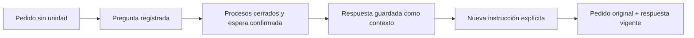

# Preguntas respondibles y continuidad del pedido

Se corrigieron los dos huecos observados: la política exige registrar las preguntas
materiales mediante la herramienta disponible, y las admisiones directas sin hilo
reciben los pedidos anteriores de su tarea con procedencia explícita. Se comprobaron
dos recorridos reales, cuatro turnos de Codex por suscripción y Ken publicado.
La comunicación integral y la comprensión humana siguen pendientes.

## Contrato y alcance

La pantalla Tareas y la pantalla Conversación **ya utilizaban un hilo**. La pérdida
observada ocurría al llamar directamente a `POST .../tasks/{task}/runs`, como hizo
el ensayo anterior. Esta distinción se verificó siguiendo el envío del frontend;
no se atribuye el fallo a toda la pantalla Tareas.

`request_history` conserva, sólo para una admisión sin hilo, los pedidos previos
de la misma tarea/proyecto hasta el orden de admisión actual. Incluye texto/hash,
run, actor, tipo, versión y estado observado; `current_authorization=false`.
No acredita autoría humana ni recepción por un modelo. Las correcciones actuales
prevalecen sobre premisas anteriores incompatibles. Los límites200/1MiB rechazan
la entrada completa antes de inferir; no muestrean ni recortan historia.

Una conversación seleccionada conserva su propio alcance. Empezar una nueva
no incorpora ocultamente los pedidos de las conversaciones anteriores. El campo
es aditivo y no altera snapshots guardados ni requiere una migración SQL.
[Contrato de entrada](../architecture/frozen-run-input.md).

El catálogo3 ordena registrar una pregunta cuando la información ausente cambia
materialmente el resultado o la próxima acción. Agrupa las dudas después del trabajo
independiente útil, evita preguntar lo ya contestado y distingue un ejemplo condicional
de una premisa confirmada. Una pregunta sólo en prosa no crea una solicitud en la
bandeja. No hay heurística de signos de interrogación ni otro loop LLM del host.
El catálogo2 conserva su versión/hash histórico al consultar entradas antiguas.
[Contrato de preguntas](../architecture/human-questions.md).

## Lo observado con ejecución real

| Recorrido | Resultado observado | Límite |
| --- | --- | --- |
| Duración sin unidad | El agente lee Ken y registra una pregunta sobre la unidad. El host confirma `waiting_input` tras cerrar peers/revocar permisos. | La respuesta del propietario se guiona; no es un estudio con una persona. |
| Respuesta y continuación | Responder «minutos» cambia el contexto sin crear un run. Una admisión explícita posterior recibe el pedido original y explica7,5×60=450segundos, con un ejemplo2minutos→120segundos. | La explicación correcta no prueba comprensión humana ni obediencia en todos los casos. |
| Corrección durante ejecución | Se retiene una respuesta real de Ken antes de entregarla; el propietario cambia base500/tasa0,07 a base80/tasa0,15. El intento anterior queda `superseded`. | Una herramienta que terminó no demuestra que el modelo recibiera su resultado retenido. |
| Explicación corregida | El segundo intento recibe ambas versiones: recargo12/total92 vigentes frente a35/535 del pedido original. Atribuye el cambio a la corrección. | Es un caso funcional, no una estimación causal del efecto de prompting. |

Los dos servicios originales terminaron con salida-15; todos sus peers están
cerrados y no quedan grants activos. Las dos explicaciones finales están
`needs_review`; no se aceptaron ni publicaron. La respuesta de la herramienta de
preguntas indicó que el intento había terminado después de guardar la solicitud:
se comprobó el estado durable, sin inferir ausencia del efecto a partir de ese error.

La suma de duración de los dos escenarios es89,576segundos; no es la duración del
bloque completo. Hay dos recibos de consumo `settled` y dos `unknown` por interrupción,
con mediciones parciales conservadas. La cifra observada de tokens está en los
[recibos reales](communication-flow-live.json); no representa facturación ni cuota.
Los casos/política se registraron antes de sus ejecuciones. Son regresiones nuevas,
no casos reservados ni una repetición del A/B anterior.

## Validación y fallos conservados

Seis pruebas reproducían la falta de historia y límites. Pasan46 pruebas de fuente
y46 desde el wheel fuera del checkout, además de5 controles del verificador.
Coinciden605 fuentes Python/SQL,324 productivas;224 módulos backend se cargaron
desde la instalación. Se preservan los snapshots existentes y el catálogo antiguo.
[Resultados](communication-flow-results.json), [paquete](communication-packaging.json),
[docstrings](communication-flow-docstrings.json).

El primer intento de preparación se rechazó por el límite de un turno de los
recursos compartidos, sin servicio ni inferencia. Se prepararon recursos privados
de dos turnos por escenario, manteniendo intacto el archivo original.

El primer escenario ejecutó ambos turnos, pero falló su verificador de fuente:
había reutilizado nombres de funciones del experimento anterior. Se corrigió para
comprobar las líneas del fixture actual y se reanalizaron los mismos recibos;
un control negativo rechaza el fixture anterior. **No se repitió ninguna respuesta.**
El resultado fallido original se conserva y la
[revalidación](communication-question-reverification.json) identifica ambos hashes.
La corrección activa se ejecutó luego como el escenario que aún faltaba, en una
instalación nueva, con el mismo caso/política ya registrados.

No cambió el frontend ni hubo una nueva auditoría visual o suite global. Los fallos
globales anteriores siguen abiertos. La revisión humana solicitada sigue sin
respuesta y no se sustituye por las respuestas guionadas de estos ensayos.

## Pendientes que permanecen

- Evaluación humana de comprensión/esfuerzo, demás perfiles y recorridos, incertidumbre,
  resultados parciales, diagramas, analogías y comunicación científica representativa.
- Revalidar60 decisiones estáticas del inventario de prompts cuyo hash de fuente o
  consumidor cambió;23 están vigentes en el corte actual. No son60 fallos de ejecución
  demostrados, pero tampoco revisiones actuales aprobadas. [Inventario](../prompts/inventory.md).
- Interfaz integral, accesibilidad, recuperación ampliada, datos históricos reales,
  seguridad de Ken/Chroma y licencias, y revisión independiente final del plan.

El detalle de estilo se difiere en DD084. Las limitaciones de calidad y cobertura
siguen en el trabajo principal, no en la cola de pulido.
