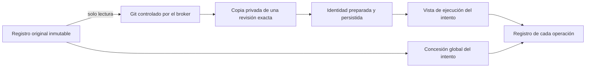

# Ejecución nativa de desarrollo: preparación aislada

Este incremento implementa la preparación interna de una copia Git privada por
intento. **El servicio público todavía no admite tareas de desarrollo.** La
escritura nativa, la entrega de candidatos, las comprobaciones, la revisión y la
publicación siguen pendientes de integración.

## Dos directorios con responsabilidades distintas

El registro original identifica el repositorio que eligió el usuario. No se
sustituye por la copia privada: será una de las precondiciones de publicación.
El directorio de ejecución identifica dónde trabajan los procesos de un intento.
Confundirlos permitiría escribir sobre el original o mezclar evidencias de dos
árboles diferentes.

`PeerRegistry.source_binding()` devuelve el registro original.
`workspace_binding()` resuelve la vista de ejecución. Para desarrollo exige una
copia preparada y autoridad vigente; no vuelve al directorio original cuando
falta la copia. La concesión global conserva el registro original y cada
operación registra por separado el directorio que realmente utilizó.

## Preparación y fallos

`DevelopmentWorkspaces` persiste la asignación antes de iniciar Git. Cada comando
pasa por el broker original, su lease y fence, su namespace y su dominio de
recursos. Solo la asignación privada es escribible; Git ve el origen en lectura.
Se requieren salida completa, código de retorno y cierre físico confirmado.

| Estado | Evidencia y comportamiento |
| --- | --- |
| `preparing` | Asignación registrada; todavía no autoriza al agente a usar la copia. |
| `ready` | Directorio, dispositivo, inode, commit base y árbol base persistidos bajo el contexto vigente. |
| `reconciling` | Preparación interrumpida o contexto cambiado; se conservan los archivos y los registros. |
| `quarantined` | Estado reservado para una futura decisión explícita de recuperación. No hay transición automática implementada. |

Repetir la solicitud no borra ni reconstruye la asignación anterior. Si el usuario
corrige el contexto después del clonado, el resultado tardío no puede convertirse
en una preparación autorizada. El propietario anterior puede dejar una observación
de fallo sobre su propio intento; esto no restaura su permiso para actuar.

Ejemplo: el usuario cambia «conserva la interfaz» mientras termina el clonado. La
copia permanece disponible para inspección, pero el agente necesita un intento
válido para trabajar con los nuevos requisitos. La existencia de archivos útiles
no demuestra que cumplan el contexto nuevo.

## Alcance demostrado

Las pruebas usan Git y aislamiento Linux reales, sin llamadas a modelos. Cubren
el origen inalterado, la copia independiente, la ausencia de configuración y
credenciales heredadas, la salida completa, la cancelación y cierre de procesos,
la corrección tardía y la negativa a reconstruir una asignación repetida. Los
fixtures de bajo nivel seleccionan explícitamente el nuevo tipo de ejecución;
esto no demuestra admisión pública de desarrollo.

Las migraciones 36 y 37 existen como recursos probados y todavía no se ejecutan
desde el arranque normal. Antes de conectarlas se requieren sus inversas seguras,
la adaptación de los constructores históricos y pruebas de actualización y
recuperación. Fuentes con metadatos compartidos, submódulos o filtros Git necesitan
una política explícita antes de admitirlas.

Los siguientes pasos son conectar la preparación con `OwnedCodexRuntime`, permitir
escritura exclusivamente sobre la copia privada, ejecutar Ken sobre esa misma
copia y entregar un candidato ligado a repositorio, base, head, contexto e intento.
Después deben integrarse comprobaciones, revisión independiente, aceptación y
publicación reconciliada. Terminar un turno o emitir texto de aprobación no cierra
ese ciclo.

Las evidencias se guardan en [development-docstrings.json](development-docstrings.json),
[development-packaging.json](development-packaging.json) y
[development-results.json](development-results.json). Sus límites forman parte del
resultado; no sustituyen las pruebas pendientes del flujo completo.
