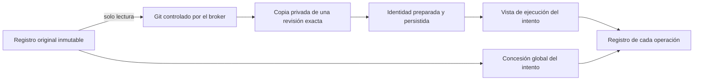

# Ejecución nativa de desarrollo: preparación aislada

El sistema prepara una copia Git privada por intento y permite escritura en ella
desde los perfiles nativos internos de desarrollo. **El servicio público todavía
no admite tareas de desarrollo.** La fábrica interna ya conecta la preparación,
el contexto, las herramientas de desarrollo, la captura durable de candidatos y
sus comprobaciones aisladas. Faltan revisión, aceptación y publicación para completar el
recorrido del producto.

## Dos directorios con responsabilidades distintas

El registro original identifica el repositorio que eligió el usuario. No se
sustituye por la copia privada: será una de las precondiciones de publicación.
El directorio de ejecución identifica dónde trabajan los procesos de un intento.
Confundirlos permitiría escribir sobre el original o mezclar evidencias de dos
árboles diferentes.

`PeerRegistry.source_binding()` devuelve el registro original.
`workspace_binding()` resuelve la vista de ejecución. Para desarrollo exige una
copia preparada y autoridad vigente; no vuelve al directorio original cuando
falta la copia. La concesión global conserva el registro original y cada
operación registra por separado el directorio que realmente utilizó.

## Preparación y fallos

`DevelopmentWorkspaces` persiste la asignación antes de iniciar Git. Cada comando
pasa por el broker original, su lease y fence, su namespace y su dominio de
recursos. Solo la asignación privada es escribible; Git ve el origen en lectura.
Se requieren salida completa, código de retorno y cierre físico confirmado.

| Estado | Evidencia y comportamiento |
| --- | --- |
| `preparing` | Asignación registrada; todavía no autoriza al agente a usar la copia. |
| `ready` | Directorio, dispositivo, inode, commit base y árbol base persistidos bajo el contexto vigente. |
| `reconciling` | Preparación interrumpida o contexto cambiado; se conservan los archivos y los registros. |
| `quarantined` | Estado reservado para una futura decisión explícita de recuperación. No hay transición automática implementada. |

Repetir la solicitud no borra ni reconstruye la asignación anterior. Si el usuario
corrige el contexto después del clonado, el resultado tardío no puede convertirse
en una preparación autorizada. El propietario anterior puede dejar una observación
de fallo sobre su propio intento; esto no restaura su permiso para actuar.

Ejemplo: el usuario cambia «conserva la interfaz» mientras termina el clonado. La
copia permanece disponible para inspección, pero el agente necesita un intento
válido para trabajar con los nuevos requisitos. La existencia de archivos útiles
no demuestra que cumplan el contexto nuevo.

## Alcance demostrado

Las pruebas usan Git y aislamiento Linux reales, sin llamadas a modelos. Cubren
el origen inalterado, la copia independiente, la ausencia de configuración y
credenciales heredadas, la salida completa, la cancelación y cierre de procesos,
la corrección tardía y la negativa a reconstruir una asignación repetida. Los
fixtures de bajo nivel seleccionan explícitamente el nuevo tipo de ejecución;
esto no demuestra admisión pública de desarrollo.

Las migraciones 36 y 37 se ejecutan desde el arranque normal. Las pruebas de
actualización preservan ejecuciones y referencias antiguas sin inventar copias de
desarrollo para ellas. Cada recurso se aplica en su propia transacción: si falla
el 37, el 36 puede quedar aplicado por completo; el siguiente arranque intenta
solo lo pendiente. No se publica un marcador para un recurso parcialmente aplicado.

`restore_code_candidates()`, `restore_development_workspaces()` y
`restore_development_kinds()` permiten retirar, en ese orden, estructuras nuevas
**sin uso**. Rechazan historial de desarrollo,
preparaciones retenidas, autoridad activa y versiones posteriores. Si un índice
propio del usuario impide cambiar la columna, la operación se revierte completa;
no se elimina ese índice para forzar el retroceso. Estas funciones son inversas
programáticas; el flujo de operador, las copias de seguridad y su CLI siguen dentro
del trabajo pendiente.

El arranque usa transacciones locales de SQLite; no se ha demostrado una migración
en línea con servidores de versiones distintas. Fuentes con metadatos compartidos,
submódulos o filtros Git necesitan una política explícita antes de admitirlas.

La identidad del origen se comprueba otra vez inmediatamente antes de abrir la
puerta del proceso. Una edición del registro del repositorio entre la reserva y
ese punto bloquea el comando y conserva evidencia de cierre sin ejecución.

## Escritura privada mediante comandos nativos

El broker obtiene el modo de acceso de una admisión vigente y de su tipo de
ejecución. Los perfiles nativos de desarrollo reciben una copia preparada y privada
en escritura; investigación, diagnósticos y Ken conservan lectura del código. El
modelo no elige rutas de montaje ni permisos. La concesión conserva el repositorio
original y cada operación registra el acceso y la vista que efectivamente utilizó.

La reserva de un comando o de inferencia valida el directorio privado contra el
intento actual, la identidad de la copia y el registro original. Pasar el directorio
original para un despacho de desarrollo se rechaza. La copia debe permanecer
separada del origen y mantener permisos privados. Los ejecutables del sistema se
montan en lectura; el alias `/bin` permite ejecutar scripts que utilizan `/bin/sh`.

Las pruebas ejecutan el binario Codex 0.166.0 real para editar archivos mediante
RPC de comandos y comprobar sus recibos. También ejercitan el perfil nativo de
App Server. La documentación de OpenAI describe `command/exec` como una operación
que no crea una conversación; este incremento no inicia turnos de modelo.
[Contrato de App Server](https://learn.chatgpt.com/docs/app-server#command-execution).

Cancelar un escritor cierra su namespace y los hijos que hayan creado otra sesión
de proceso. Se conserva lo ya escrito; un cierre confirmado no convierte esos
archivos en un candidato aceptado. Repetir un lanzamiento devuelve su recibo sin
abrir otra puerta de ejecución. Las pruebas también usan un proceso con la forma
de Ken para comprobar lectura del código actualizado en esa misma copia y negativa
de escritura.

## Sesión interna y actualización del índice de Ken

`OwnedCodexRuntime` prepara la copia antes de iniciar los procesos de desarrollo.
La entrada persistida identifica el repositorio, la base y el intento, y explica
que editar no acepta ni publica la tarea. Las herramientas de desarrollo excluyen
la propuesta de resultados de investigación; un permiso de investigación no se
convierte en permiso de desarrollo. Las instrucciones exigen distinguir evidencia
de suposiciones, explicar con ejemplos y documentar el código con docstrings en
inglés para facilitar su búsqueda.

Un índice preparado antes de una edición puede quedar obsoleto. La comprobación
con `ken-rank` 0.18.0 publicado reprodujo este fallo al buscar un símbolo nuevo.
`DevelopmentKen` calcula una huella acotada del código mediante procesos propios
en lectura. Cuando cambia, cierra el MCP anterior, prepara de nuevo el índice y
abre otro MCP bajo el mismo propietario. Un único task conserva la propiedad de
los contextos del SDK durante su apertura, uso y cierre. Las lecturas repetidas y
las escrituras internas de `.ken` no fuerzan otra preparación.

Antes de consultar código se exige que no queden escritores activos; se comprueba
la huella después de la consulta y se rechaza el resultado si cambió entre ambos
puntos. Se mantienen disponibles las herramientas para leer o cancelar el comando.
Si la cancelación cierra el proceso pero no obtiene un resultado final fiable,
el intento pasa a reconciliación y no continúa consultando ni ejecutando efectos.
El cierre físico no demuestra qué modificaciones se completaron.

La prueba con el paquete publicado encontró un símbolo añadido en un archivo
editado y otro en un archivo nuevo, mantuvo intacto el origen y cerró todos los
procesos propios. Usó llamadas controladas a herramientas en una sesión interna;
no inició generación de modelo ni demuestra admisión pública, revisión de código
o publicación. La huella tiene límites de 20.000 entradas, 256 MiB y diez segundos;
superarlos bloquea la consulta. No constituye una captura atómica del candidato.

La [captura de candidatos](code-candidates.md) ya produce un commit, un árbol y un
diff completos en una asignación independiente mediante Git propio. El controlador
interno cierra los escritores y persiste la captura ligada al contexto e intento.
Las [comprobaciones aisladas](code-checks.md) ya consumen esa versión y conservan
resultados ligados al candidato. La [revisión independiente](code-reviews.md)
conecta sesión nativa, Git antes/después, citas verificadas y cierre, con validación
ampliada y ensayo real de suscripción documentados. La [aceptación humana](code-acceptance.md) ya tiene API y panel. La entrada pública de desarrollo y la publicación reconciliada siguen pendientes
para cerrar el recorrido. Terminar un turno
o emitir texto de aprobación no cierra ese ciclo.

Las evidencias se guardan en [development-docstrings.json](development-docstrings.json),
[development-packaging.json](development-packaging.json) y
[development-results.json](development-results.json). La integración posterior del
arranque tiene evidencia separada en
[development-startup-results.json](development-startup-results.json),
[development-startup-packaging.json](development-startup-packaging.json) y
[development-startup-docstrings.json](development-startup-docstrings.json).
La escritura privada se verifica en
[development-write-results.json](development-write-results.json),
[development-write-packaging.json](development-write-packaging.json) y
[development-write-docstrings.json](development-write-docstrings.json).
Sus límites forman parte del
resultado; no sustituyen las pruebas pendientes del flujo completo.
