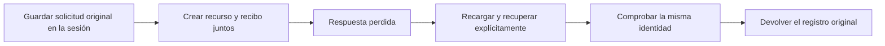

# Creaciones de grupos e hitos recuperables

La repetición de una solicitud creaba otro grupo o hito. Ahora el servidor guarda
el recurso y su recibo en la misma transacción; la web conserva la solicitud antes
de enviarla y comprueba su identidad al recibir respuesta. **Planificación sigue
en aceptación: este bloque no acepta la página completa.**

Bloque iniciado04:27:54UTC sobre `4607e8e`; recorrido terminado05:13:48UTC y
evidencia/inspección comprobadas05:25:17UTC: **57 min 23 s hasta verificar esta fase**.
Incluye el diagnóstico inicial y trabajo de dos turnos, no sólo ejecución de tests.

## Entrada y resultado observados

En un proyecto sintético llamado «Atlas comprobable» se pidió crear el grupo
«Reunir evidencia». El servidor creó el grupo1, pero se cortó la respuesta después
de confirmar la escritura. El formulario conservó los datos originales. Tras
recargar y elegir «Recuperar la misma creación», recibió el grupo1 otra vez.
Se repitió el caso con el hito «Datos contrastados»: conservó el hito1.
Son tablas distintas; no se deduce identidad a partir del nombre o del número solo.

Las respuestas HTTP reales, las claves originales y las dos filas de SQLite
coinciden. Quedaron un grupo, un hito, dos tareas manuales con dependencia y
**dos recibos de creación**. Cero runs, despachos e inicios nativos; cero turnos
generativos. El servicio terminó con143 y su guardián retiró el dominio.
No se reabrió el plan pagado ni el intento fallido originales.

## Contrato implementado

- `OwnerPlanningRecords` valida alcance e intención dentro de una transacción
  inmediata. Misma clave/contenido devuelve la respuesta original; cambiar el
  contenido o el tipo de operación con esa clave produce409 sin otro efecto.
- Una respuesta de creación es un recibo histórico, no una lectura del estado
  actual. Recuperarla después de editar metadatos no revierte la edición. Un
  recurso retirado no se recrea; los IDs de estas tablas son AUTOINCREMENT.
- La web verifica clave, proyecto y, para hitos, grupo. No interpreta un HTTP
  exitoso como identidad suficiente. Conserva peticiones por proyecto/tipo/padre,
  no borra otra más reciente y evita redirigir una visita nueva por una respuesta
  tardía A→B→A. Si no puede guardar la solicitud, no la envía.
- Usa sessionStorage, integrado en el archivo de solicitudes al cambiar de
  instalación. Una solicitud anterior no se vuelve a asignar a otra base.
  Retirar su copia local es explícito y no deshace un efecto ya confirmado.
- Los clientes antiguos sin clave conservan su comportamiento de una llamada;
  no se les atribuye recuperación de una respuesta perdida. Todos los envíos de
  la web nueva llevan identidad y ámbito. No hay otro loop ni generación.

La migración69 añade una tabla de recibos por proyecto, evitando reescribir todo
metadata_json en cada alta. Las solicitudes/respuestas guardadas no se actualizan.
La retirada de un proyecto sigue las protecciones existentes y elimina sus recibos
locales por cascada. La inversa sólo admite infraestructura sin recibos ni versión
posterior. Se probaron rollback real, crash antes del commit de versión y
backup/restauración del producto conservando IDs y respuestas.

El borrado de grupos/hitos comprueba historia nativa y agrupaciones de planes
aceptados bajo el mismo bloqueo de escritura. Conserva tareas y dependencias.
Una admisión anterior impide retirar el grupo; una retirada anterior cambia la
versión de entrada y rechaza la admisión obsoleta. Son dos órdenes comprobados,
no una medición de todos los interleavings. Dos escritores coordinados recuperan
un solo recibo. También se corrigió un fallo previo de PUT: escribía `updated_at`,
columna inexistente en estas tablas. No se inventaron fechas de actualización.

## Comprobaciones y límites

23 casos dirigidos de origen pasan. Una selección anterior de67 incluye migraciones
y solapa estos casos: no se suman como90 escenarios. **124 casos instalados pasan**,
sin fallos/omisiones, en52,98s;243 módulos backend vienen del entorno no editable.
Los684 Python/SQL empaquetados coinciden,365 productivos; `uv pip check` pasa.
42 definiciones nuevas/modificadas tienen docstrings en inglés y el frontend tiene
JSDoc relevante. Pasan148 contratos,51 casos UI, TypeScript y compilación.

El navegador conserva10 estados del recorrido compartido; sólo4 son de Planificación.
Se revisaron éstos contra tree-detail. No se fabricaron respuestas: se hizo
`route.fetch` al servidor real y se abortó sólo la entrega posterior al commit.
Las regiones incluidas no tienen incidencias Axe ni desbordamiento; eso no prueba
comprensión humana, zoom nativo ni accesibilidad completa. Los nombres y ejemplos
son sintéticos, no una evaluación humana de comunicación.

Ruff conserva4 avisos; el archivo de tipos compartido mantiene un `any` anterior.
Los componentes/hooks/helpers nuevos pasan ESLint. El bundle grande ya advertido,
el error de red en inglés y la redacción del vacío de una consulta antigua quedan
en DD132/anteriores. No se declara estilo o suite global verdes. La comprobación
actual de prompts deja67 revisiones desactualizadas de85 en 318 archivos: no se renuevan
huellas a ciegas ni se confunde desactualización con un fallo semántico demostrado.

**Siguiente en la misma página:** propuestas/historia, borrado y protección desde
la UI real, errores de lectura, datos extensos y teclado/móvil restantes. Siguen
3/12 páginas,41/43 escenarios, U08/C10 y contención original abiertos; detalles y
gates globales al final. Sin push, merge o despliegue.

[Resultados](planning-commands-results.json),
[paquete](planning-commands-packaging.json),
[docstrings](planning-commands-docstrings.json),
[estilo](planning-commands-lint.json),
[auditoría visual acotada](../design/audits/2026-11-08-planning-creation-recovery/report.md),
[plan en curso](../superpowers/plans/2026-11-08-planning-page-acceptance.md).
