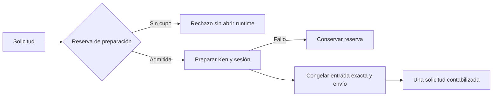

# Admisión antes de preparar Ken y el runtime

Base fe3da17. Bloque medido **2026-11-07 17:53:04–18:07:01 UTC**, **13 min 57 s
hasta validación**. Documentación/checkpoint posteriores fuera del tramo.
El chat dio una aproximación errónea de16min, corregida con el reloj a13min24s;
la duración anterior es la medición final, no una estimación del trabajo restante.

Se comprobó un hueco real: RuntimeService abría el runtime antes de reservar el
presupuesto. OwnedCodexRuntime podía preparar Ken y la sesión nativa aunque luego
rechazara el turno por falta de cupo. La prueba existente sólo exigía ausencia de
turn/start; su docstring permitía expresamente preparación previa.

Ahora una reserva durable por intento precede a runtime.open y a emitir el grant
de herramientas. Un proyecto sin capacidad no arranca esa preparación. La reserva
es inmutable y no permite repetirla con la misma identidad tras incertidumbre.
Un fallo antes del envío conserva capacidad; una nueva solicitud explícita necesita
su propio cupo. Una reducción posterior de política gobierna admisiones futuras,
sin revocar una preparación que ya reservó capacidad.

La entrada exacta sigue congelándose después de conocer catálogo, workspace y
modelo reales. Su transacción no inventa datos previos: al crear el dispatch,
la consulta de uso reemplaza la reserva de preparación por ese dispatch. No suma
dos solicitudes. Si falla el congelado, el dispatch revierte y la preparación
anterior permanece. Un dispatch histórico sin preparación se conserva igual.
La misma comprobación transaccional sirve a las dos entradas de almacenamiento.

La migración64 añade runtime_preparation_reservations. Su inversa sólo permite
retirar la versión más reciente cuando no tiene reservas; preserva dispatches
históricos. La cadena de migraciones prueba el corte antes del commit de64 y su
recuperación. Los registros administrativos business/native se crean al reclamar
el intento; no son procesos arrancados. Rechazar el presupuesto deja esos registros
cerrados, sin PID de hijo ni registro Ken, y sin grant de herramientas.

El presupuesto expone preparation_only. El historial conserva
preparation_token_ceiling por intento. La web explica que son preparaciones sin
reserva de envío y que capacidad reservada no equivale a tokens consumidos.
Un contador de solicitudes limita cuántas preparaciones se admiten; no convierte
CPU de Ken en tokens ni mide toda la CPU del servicio. Los límites físicos previos
siguen vigentes. Fallos de cierre físico mantienen su incertidumbre original.

Validación:

- Cinco pruebas iniciales fallaron, incluida la observación real de open cuando
  el proyecto no tenía cupo. Después pasaron11casos dirigidos.
- Selección ampliada desde fuente:163casos,161pasan y2fallan por expectativas del
  ensayo. Se corrigió exigir cero registros administrativos cuando lo relevante
  es cero procesos arrancados, y se movió la versión inválida de64a65.
- Paquete final instalado fuera del checkout: **163pasan,0fallos,0omisiones** en
  76,992s;646archivos Python/SQL idénticos,344de producto;250módulos importados
  sólo desde el entorno no editable. Incluye carrera por último cupo, fallo y
  reinicio, conversión, política reducida, rollback de input, migraciones,
  recuperación local y recorridos del coordinador. Generación controlada.
- Diez pruebas DOM y build pasan. Advertencia de chunk grande ya conocida.
  No se hizo otra auditoría de navegador ni se acepta una página completa.
- 33 definiciones/clases Python modificadas/nuevas documentadas, módulos con
  docstring; JSDoc relevante conservado. Inventario:302archivos,85candidatos,
 85 revisados,0pendientes. Los tres candidatos afectados sólo cambiaron de hash de
 consumidor: su contenido y llamadas de composición permanecieron iguales.

No hubo turnos de modelo, cambios de dependencia ni pruebas con cuentas externas.
La última suite global con fallos sigue siendo histórica; esta selección no la
reemplaza. E08 amplio sigue abierto: contrastar la cobertura de llamadas y consumo
observable de dominios nativos/Ken y administración con lo que muestra el producto,
separando telemetría disponible de ausencia real. No prometer cuota/facturación
interna del proveedor ni contabilidad global entre instalaciones.

[Paquete](preparation-budget-packaging.json), [resultados](preparation-budget-results.json),
[docstrings](preparation-budget-docstrings.json),
[plan del bloque](../superpowers/plans/2026-11-07-preparation-budget.md).
