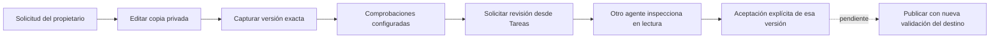

# Desarrollo y revisión desde Tareas

El perfil `owned-codex-v1` admite tareas `code` y `bug_fix` desde las entradas
existentes de Tareas y Conversación. Usa el mismo propietario durable, la copia
privada, Codex por suscripción y Ken obligatorio. El adaptador anterior conserva
admisión de investigación; no recibe capacidades de desarrollo por compatibilidad.



Ejemplo: pedir «cambia 137 por 200» permite editar la copia privada. El host
captura el diff completo y ejecuta las comprobaciones configuradas. Después puedes
encargar a otro agente revisar esa versión contra la petición original. Una
revisión favorable permite ofrecer la aceptación cuando se cumplen sus demás
condiciones. El repositorio original continúa intacto: aceptar no publica.

## Entrada y capacidades

`GET /api/projects/{project}/tasks/{task}/workspace` declara sólo los tipos que
admite el adaptador configurado. Sin configuración devuelve una lista vacía.
`POST /api/projects/{project}/tasks/{task}/runs` y la instrucción tipada de
Conversación reutilizan `RuntimeService.submit`; no hay otro coordinador LLM.
El tipo de tarea determina el perfil; el cliente no elige permisos ni montajes.

Tras un turno de desarrollo completado, el propietario exige una captura `ready`
y ejecuta las recetas de host. Si esa preparación falla, conserva evidencia y
registra `code_candidate_unconfirmed`; no convierte el turno completado en una
entrega comprobada. Si una receta termina con un resultado negativo, ese resultado
permanece visible y bloquea la aceptación según su clasificación. Stop, corrección,
leases y cierre físico conservan las reglas del recorrido existente.

## Comprobaciones explícitas del host

La configuración JSON del perfil permite `development_checks`. El valor por
defecto es `[]`: significa ausencia de comprobaciones, no pruebas aprobadas.
El panel muestra ese límite y la aceptación requiere el reconocimiento previsto
por su política. No se deduce un comando por los nombres de archivos ni se
instalan dependencias automáticamente.

Ejemplo de receta que **comprueba un valor, no ejecuta una suite de pruebas**:

```json
{
  "development_checks": [
    {
      "argv": [
        "/usr/bin/python3", "-c",
        "from pathlib import Path; assert Path('fact.txt').read_text() == '200'"
      ],
      "framework": "command",
      "environment_id": "system",
      "timeout_seconds": 10,
      "output_bytes": 65536
    }
  ]
}
```

Las recetas son inmutables, con ejecutable absoluto, entorno `system` o
`runtime-python`, protocolo `command` o `pytest` y límites validados. Se admiten
hasta ocho; los campos desconocidos o entornos no disponibles se rechazan.
Cada receta y su huella quedan incluidas en las instrucciones originales
congeladas antes de la inferencia. El host ejecuta cada una después de la captura,
en una copia independiente, bajo el dominio original. La suma del trabajo sigue
sujeta al plazo global del propietario; configurar ocho recetas no amplía ese
plazo. Modelo y recetas se configuran en el JSON global con reinicio; no hay aún
selector web ni políticas distintas por proyecto.

## Revisión solicitada por el propietario

`POST /api/projects/{project}/tasks/{task}/code-reviews` recibe clave de operación,
contexto observado, intento del autor, huella completa del objeto y petición de
revisión. El host elige `code-reviewer`, exige un autor distinto y aplica el
contrato de [revisión independiente](code-reviews.md). El cliente no puede aportar
actor, ruta del candidato, repositorio alternativo o autorización de publicación.
El acceso usa la sesión emparejada y CSRF del propietario.

El control de Tareas muestra qué comprobará el revisor y permite añadir un ejemplo.
Guarda el cuerpo completo antes del envío. Si se pierde la respuesta, recargar
mantiene la misma versión, contexto, petición y clave; «Reenviar la misma revisión»
consulta la admisión idempotente y no agenda otra inferencia. Un rechazo definitivo
puede descartarse explícitamente; una respuesta incierta conserva el intento.
Una solicitud guardada no demuestra que el revisor haya comenzado o terminado.

## Evidencia y límites de esta entrega

- Diez pruebas dirigidas pasan: recorrido HTTP completo hasta aceptación, recibos
  repetidos, huella obsoleta, ámbitos/identidad del cliente rechazados, recetas,
  adaptador sin soporte y fallos de captura/comprobación tras turno completado.
  El recorrido usa Git, SQLite y aislamiento Linux reales; generación y Ken del
  fixture son controlados. No hubo nuevas llamadas a modelos reales.
- Pasan 51 pruebas de consumidores de servicio, workspace, admisión e input.
- El frontend pasa 75 pruebas y build. Se conserva el aviso previo de tamaño del
  bundle y de datos Browserslist antiguos.
- [Seis capturas y auditoría](../design/audits/2026-11-02-public-development/report.md)
  verifican escritorio, móvil, respuesta perdida, recarga y recibo original. El
  navegador usa testigos Git/cierre sintéticos y retiene el revisor en cola;
  no sustituye la integración nativa dirigida anterior.
- [22 definiciones Python documentadas](public-development-docstrings.json),
  módulos y helpers frontend con JSDoc. No es una auditoría global de docstrings.

El wheel ampliado pasa [84 casos](public-development-packaging.json) en 147,60 s,
con 352 módulos sólo del paquete. Después se añadió únicamente el docstring
faltante de `workspace`: [comparación completa de payloads y AST sin docstrings](public-development-package-docstring-delta.json).
El [wheel final](public-development-final-packaging.json) pasa otros 11 casos,
292 módulos sólo del paquete y 698 fuentes Python/SQL coincidentes.

La suite global de integración se inició con plazo de 180 segundos por
caso. La primera invocación heredó por error el plazo ordinario de 20 segundos;
se detuvo mediante SIGINT y se esperó su salida antes de reemplazarla.
[Registro del error de verificación](public-development-verification-retry.json).
No se interpretan esos timeouts como regresiones demostradas ni se atribuye la
suite de la entrega anterior al código nuevo. La invocación corregida se
interrumpió mediante SIGINT y terminó con salida 2 para cumplir la pausa explícita
del propietario; no queda ejecutándose ni acredita un resultado global completo.
[Resultados y límites](public-development-results.json).
Publicación reconciliable, migración de consumidores/loops antiguos,
evaluaciones representativas de prompts/comprensión, operación y aceptación
completa de las doce páginas siguen pendientes en el plan completo.
