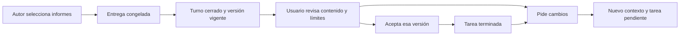

# Entrega explícita y aceptación de investigaciones

Este bloque conecta una entrega de informes con una decisión del usuario sobre una
versión concreta. Terminar un turno, escribir «VALIDATED» o guardar un borrador no
completa la tarea. La aceptación tampoco publica un informe ni convierte sus
conclusiones en hechos científicamente validados.

## Lo implementado

1. El autor usa `researcher_result_propose` para seleccionar sus informes finales,
   escribir una síntesis y declarar sus límites. Solo puede seleccionar informes
   realmente escritos por su intento admitido. Los borradores exploratorios quedan
   fuera salvo selección explícita. El revisor no recibe esta capacidad.
2. Se conserva una captura inmutable de los informes, hallazgos, citas, fuentes,
   procedencia y requisitos de la tarea. Incluye los textos originales de las
   fuentes. Cambiar requisitos o dependencias impide aceptar una observación antigua.
3. La interfaz permite leer el informe entregado por partes, ver los límites del
   autor y distinguir revisiones ausentes, incompletas o antiguas. Las comprobaciones
   de hallazgos no se presentan como una revisión del informe completo.
4. Aceptar requiere una sesión del propietario, protección CSRF, la identidad y
   huella de la entrega, la versión de contexto y la huella de revisión observada.
   Si falta revisión independiente o tiene límites, el usuario debe reconocerlos
   explícitamente. Ese reconocimiento queda vinculado a las huellas mostradas.
5. La decisión queda registrada de forma inmutable y atómica con la tarea terminada
   y el intento aceptado. Hallazgos e informes mantienen sus estados científicos.
6. Pedir cambios guarda una corrección y reabre una tarea previamente aceptada.
   Conserva el informe y la decisión anteriores; no inicia otra ejecución. Editar
   los requisitos de una tarea aceptada también la reabre.

La confirmación del propietario demuestra que realizó esa acción. No demuestra
que haya comprendido todo el contenido ni que sus conclusiones sean verdaderas.

## Reintentos y estados difíciles

| Si ocurre… | Comportamiento |
| --- | --- |
| El agente termina sin seleccionar una entrega | No se inventa una selección a partir de sus borradores o su resumen. |
| El usuario pierde la respuesta de aceptación | La pestaña conserva la solicitud original; consultar la misma decisión recupera su recibo. |
| Se recarga la página o se cambia de proyecto | La decisión pendiente conserva proyecto, tarea, ejecución, huellas, contexto y clave. No se reenvía automáticamente. |
| Aparece una ejecución de autor más reciente | La decisión pendiente de la ejecución anterior sigue siendo localizable; el usuario también puede elegir entregas anteriores. |
| Se reintenta una aceptación después de corregir la tarea | Se devuelve el recibo histórico sin volver a completar la nueva versión de la tarea. |
| Cambian los requisitos, el informe o sus dependencias | La entrega permanece consultable; la aceptación antigua no autoriza aceptar esa versión distinta. |
| Falta comprobar el cierre de otro trabajo | La aceptación permanece bloqueada hasta reconciliar su autoridad. |
| Una revisión expresa dudas o falta por completo | Se muestra como límite; no se transforma en una aprobación implícita. |
| Un flujo antiguo intenta aprobar una tarea nativa | Los adaptadores y la base impiden saltarse la aceptación del propietario. |
| Cambian requisitos y estado dentro de una actualización | El índice de tareas se actualiza solo al cambiar sus columnas de texto, evitando la eliminación anidada de texto todavía sin indexar. |

Los flujos de investigación y revisión antiguos comprueban la propiedad nativa
antes de elegir agentes o iniciar inferencia. Las herramientas antiguas de
aprobación, validación y rechazo conservan su funcionamiento para tareas sin
admisión nativa. Esto no supone que todos los motores y proveedores antiguos
hayan sido retirados del proyecto.

## Contratos y límites

- La entrega admite de 1 a 20 informes seleccionados, hasta 200 hallazgos,
  1.000 referencias y 200 fuentes distintas; la captura completa está limitada
  a 2 MiB. Los tamaños se comprueban en SQLite antes de cargar textos grandes
  y nuevamente sobre el JSON canónico. Un exceso produce un error explícito,
  nunca una entrega parcial silenciosa.
- Los informes pueden consultarse en ventanas de hasta 20.000 caracteres.
  La interfaz lee la captura original, aunque el borrador actual cambie.
- `results.propose` pertenece al autor admitido y vinculado al intento actual.
  Conocer un identificador o tener un nombre de rol parecido no concede autoridad.
- Las claves de aceptación pertenecen a proyecto y tarea. Una misma clave con
  otra intención produce conflicto; repetir la intención recupera el recibo.
- La migración 35 es reversible únicamente antes de que exista historia de
  entregas/aceptaciones y sin autoridad viva ni migraciones posteriores. Conserva
  tareas y tablas ajenas. Tras una entrega se requiere reparación hacia adelante
  o restauración explícita de una copia de seguridad.

| Operación | Endpoint |
| --- | --- |
| Entregar desde el autor | `POST /api/research-tools/result-proposals` |
| Consultar estado como propietario | `GET /api/projects/{project_id}/runs/{run_id}/result` |
| Leer un informe congelado | `GET /api/projects/{project_id}/runs/{run_id}/result/candidates/{candidate_id}/reports/{report_id}` |
| Aceptar la versión observada | `POST /api/projects/{project_id}/runs/{run_id}/result/accept` |
| Pedir cambios sin inferencia | `POST /api/projects/{project_id}/tasks/{task_id}/context-corrections` |

Las consultas de entrega y sus informes llevan `Cache-Control: no-store`.
Las credenciales de herramientas no sirven como credenciales del propietario.

## Evidencia y trabajo restante

La evidencia de este bloque se registra en `result-packaging.json`,
`result-results.json`, `result-docstrings.json` y en la auditoría visual
`../design/audits/2026-11-02-result-acceptance/interaction-evidence.json`.
Las pruebas dirigidas distinguen ejecución controlada, navegador con datos
sintéticos y un turno real de suscripción; ninguna equivale a una evaluación
científica general.

El tipo implementado es `research_reports`. No autoriza entregas de código,
Git, integración, despliegues ni publicación. Esas capacidades necesitan sus
propios contratos de repositorio y versiones. Continúan pendientes la migración
completa de productores y bucles antiguos, la aceptación completa de las doce
rutas, los escenarios amplios del plan, los fallos heredados y la revisión
independiente final de la rama.
